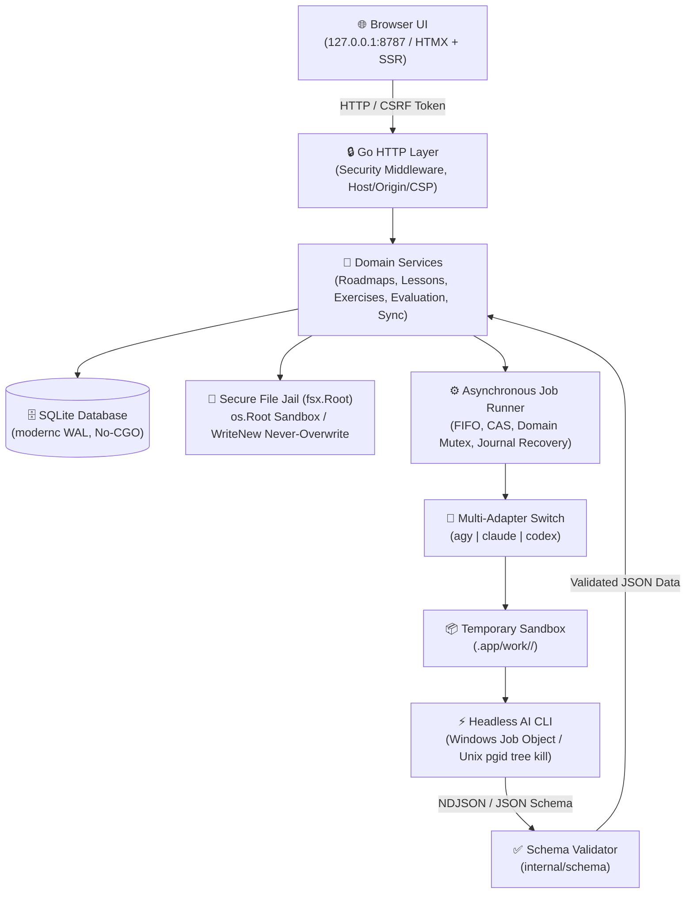

# Learning Hub 🚀

> **Autonomous, Local-First AI Learning Assistant for Software Engineers and Developers**  
> Transform standard Markdown roadmaps into interactive, personalized curriculum with autonomous lesson generation, starter code templates, automated evaluation, and rigorous academic scoring.

[](https://go.dev/)
[-003B57?style=flat&logo=sqlite)](https://modernc.org/sqlite)
[](https://htmx.org/)
[](LICENSE)
[](#installation-guide)

---

## 📖 Table of Contents
- [Overview](#-overview)
- [Key Features](#-key-features)
- [Architecture & Design Principles](#-architecture--design-principles)
- [Prerequisites: AI CLI Engines](#-prerequisites-ai-cli-engines)
  - [1. Google Antigravity (Default)](#1-google-antigravity-agy--default)
  - [2. Anthropic Claude Code](#2-anthropic-claude-code-claude)
  - [3. OpenAI Codex](#3-openai-codex-codex)
- [Installation Guide](#-installation-guide)
  - [Option A: Pre-compiled Single Binary (Recommended)](#option-a-pre-compiled-single-binary-recommended)
  - [Option B: Building from Source](#option-b-building-from-source)
- [Step-by-Step Workflow](#-step-by-step-workflow)
- [Command Line Interface (CLI)](#-command-line-interface-cli)
- [Configuration Reference (`config.toml`)](#-configuration-reference-configtoml)
- [Data Storage & Directory Layout](#-data-storage--directory-layout)
- [Reliability, Crash Recovery & Security](#-reliability-crash-recovery--security)
- [Development & Verification](#-development--verification)

---

## 🌟 Overview

**Learning Hub** is an open-source, local-first platform that turns any programming or engineering syllabus into an end-to-end interactive learning environment. 

Unlike conventional AI tools that unsafely mutate your disk files or execute arbitrary unconfined code, **Learning Hub enforces strict deterministic separation**:
- **The AI acts exclusively as an inference engine** inside isolated, temporary sandboxes, returning strictly structured JSON schema.
- **The Go core engine deterministically controls all disk I/O, database persistence, grading calculations, and file protection.**
- **Your work is permanent and immutable:** your code answers and evaluations are protected by a strict never-overwrite guarantee (`fsx.WriteNew`).

---

## ✨ Key Features

- 🗺️ **Roadmap Ingestion & AST Parsing:** Upload any Markdown roadmap (GitHub READMEs, personal notes, syllabi). The engine parses AST with `goldmark` using flexible rules (`deepest`, `level`, `items`, `chapters`, or `tree`).
- 🔄 **Intelligent Re-import Diff Engine:** Update your syllabus at any time without losing study history. Fuzzy Levenshtein diffing highlights new, changed, archived, and unchanged topics.
- 📚 **Comprehensive Lesson Publishing:** Generates deep, contextual lessons in Persian with bi-directional (`<bdi>`) isolation for English code and terms, complete with automated XSS sanitization (`bluemonday`) and revision history (`lesson.NNNN.md`).
- ✍️ **Structured Exercise Sets & Starter Code:** Decomposes lessons into structured practical exercises (`q01`..`qNN`) with language-specific comment headers (`@hub`), starter code, manifest contracts, and evaluation rubrics.
- 🎯 **Automated Evaluation & Pure Deterministic Scoring:**
  - **Incremental & Full Modes:** Grade only modified/new answers while carrying forward unchanged scores.
  - **Isolated Sandboxing:** Grades each exercise independently with persistent checkpoints.
  - **Deterministic Math:** Pure software calculations (`internal/scoring`) sum exact rubric points and calculate weighted topic averages—ignoring any AI hallucinated score totals.
- 🛡️ **Anti-Cheating & Quality Guards:**
  - *Prompt Injection Guard:* Flags student answers attempting to hijack evaluation instructions.
  - *Template High Score Guard:* Detects unmodified starter code receiving unwarranted high marks.
  - *Score Mismatch Detection:* Reconciles discrepancies between criterion points and summary numbers.
  - *Confidential Rubrics:* Rubrics remain strictly locked (HTTP 403) until all exercises have been answered and evaluated.
- 🗃️ **Sync & Disaster Recovery:**
  - **Sync Service:** Scans on-disk user file moves/renames and syncs database metadata atomically via SHA-256 matching.
  - **Database Rebuild:** 100% reconstructs the SQLite database from plain on-disk Markdown and JSON files if the database is deleted or corrupted.

---

## 🏛️ Architecture & Design Principles



### Core Invariants
1. **No CGO:** Uses `modernc.org/sqlite` for zero-dependency compilation across Windows, Linux, and macOS without GCC or MinGW.
2. **Never-Overwrite (`fsx.WriteNew`):** Answers, previous lesson versions, and grade reports are never replaced in-place. File writes occur via temporary files + atomic links + directory `fsync`.
3. **Directory Confinement (`os.Root`):** All filesystem operations are jailed within the user-specified base directory.
4. **Scope-Level Mutual Exclusion:** Only one active job (lesson generation, exercise creation, or evaluation) can run per topic at any given moment.
5. **Headless Multi-Adapter Orchestration:** Full, seamless switching between Antigravity, Claude Code, and Codex without restarting the server.

---

## 🤖 Prerequisites: AI CLI Engines

Learning Hub executes AI CLI tools in **headless mode**. At least **one** of the following tools must be installed, authenticated, and available in your system's `PATH`.

### 1. Google Antigravity (`agy` — Default)
- **Installation:** Install the Antigravity CLI and verify with `agy --version` (tested on v1.5+).
- **Authentication:** Launch `agy` in your terminal and run `/login`. Verify that `agy models` lists available models.
- **Default Model:** `gemini-3.8-flash-medium` (or any model listed in `agy models`).
- **Execution Flags:**
  ```bash
  agy --dangerously-skip-permissions -p <prompt> --output-format stream-json --json-schema <work>/output.schema.json --model <model> --effort <effort> --print-timeout <t> --sandbox
  ```
  *Note:* The `--dangerously-skip-permissions` flag is mandatory in headless mode so `agy` does not block on approval prompts.

### 2. Anthropic Claude Code (`claude`)
- **Installation:** Install Claude Code via npm (`npm install -g @anthropic-ai/claude-code`) and verify with `claude --version`.
- **Authentication:** Run `claude auth login` and ensure `claude auth status` reports `loggedIn: true`.
- **Execution Flags:** Run safely confined to the workspace with read-only tools:
  ```bash
  claude -p <prompt> --tools Read,Glob,Grep --allowedTools "Read(./**),Glob(./**),Grep(./**)" --no-session-persistence --strict-mcp-config --setting-sources ""
  ```
- *Environment:* Claude processes inherit environment variables (e.g., `ANTHROPIC_API_KEY`).

### 3. OpenAI Codex (`codex`)
- **Installation:** Install Codex CLI and ensure `codex --version` works.
- **Authentication:** Run `codex login` and verify status.
- **Execution Flags:**
  ```bash
  codex exec --json --skip-git-repo-check --sandbox read-only ...
  ```

---

## 📦 Installation Guide

### Option A: Pre-compiled Single Binary (Recommended)

1. Download the release binary for your platform from the [Releases](https://github.com/your-org/learnai/releases) page:
   - **Windows:** `hub.exe`
   - **Linux:** `hub`
2. Create a dedicated directory for your learning hub (e.g., `C:\LearningHub` or `~/learninghub`).
   > ⚠️ **Important:** Do NOT place this directory inside a cloud-synced folder (such as OneDrive, Dropbox, or Google Drive) to prevent file-locking conflicts with SQLite WAL.
3. Place `hub.exe` or `hub` inside your learning directory (or add it to your system `PATH`).
4. Run the health check:
   ```bash
   hub doctor
   ```
   If all components pass, you will see `[OK] ready`.

---

### Option B: Building from Source

**Requirements:** Go 1.24 or higher and Make (optional).

```bash
# 1. Clone the repository
git clone https://github.com/your-org/learnai.git
cd learnai

# 2. Run the automated test suite
go test ./cmd/... ./internal/... ./skills/...

# 3. Build single binary
go build -o hub cmd/hub/main.go          # On Linux/macOS
go build -o hub.exe cmd/hub/main.go      # On Windows

# Or build verified reproducible release binaries
make release
```

---

## 🚀 Step-by-Step Workflow

### 1. Run Environment Diagnostics
Verify that your base directory is writable and that your configured AI CLI is authenticated:
```bash
hub doctor
```

### 2. Start the Local Hub Server
```bash
hub serve
```
By default, the server binds exclusively to the local loopback interface: **[http://127.0.0.1:8787](http://127.0.0.1:8787)**.

### 3. Import a Roadmap
1. Open [http://127.0.0.1:8787](http://127.0.0.1:8787) in your browser.
2. On initial startup, review and accept the Privacy Notice in **Settings**.
3. Click **"ورود نقشه راه" (Import Roadmap)**.
4. Upload any Markdown file containing syllabus headings.
5. Select a parsing strategy:
   - `deepest` (Default): Extracts the deepest nested headings as curriculum topics.
   - `chapters`: Segregates topics into distinct chronological chapters.
   - `tree`: Retains full parent-child hierarchy.
   - `items`: Converts markdown lists into study topics.
6. Review the interactive preview and click **Confirm**.

### 4. Study Lessons
1. Navigate to any topic in your library.
2. Click **"تولید درس" (Generate Lesson)**. The Job Runner will enqueue and execute the task in the background.
3. The lesson is rendered with syntax-highlighted code blocks, clear terminology, and automatic RTL/LTR isolation.
4. Regenerating a lesson archives the previous version safely in `lesson/history/lesson.0001.md`.

### 5. Practice with Exercises
1. Open the **"تمرین‌ها" (Exercises)** tab.
2. Click **"تولید تمرین‌ها" (Generate Exercises)**. The AI produces 3–12 modular tasks (`q01`, `q02`, ...) with starter code templates and a grading rubric.
3. Switch to the **"فایل‌های پاسخ" (Answer Files)** tab.
4. Click **"کپی مسیر" (Copy Path)** next to any exercise.
5. Open the file in your preferred code editor (VS Code, GoLand, PyCharm, Neovim) and implement your solution beneath the `@hub` comment header.

### 6. Evaluate and Review Reports
1. In the topic panel, open the **"گزارش‌ها" (Reports)** tab.
2. Select **Incremental Evaluation** (recommended) or **Full Evaluation**, and click **"شروع ارزیابی"**.
3. Review your grade breakdown:
   - Detailed feedback per question (`q01-report.md`) with criteria breakdown, strengths, and actionable educational tips.
   - Overall topic summary score (`summary.md`).
   - Machine-readable progress card (`result.json`).

---

## 💻 Command Line Interface (CLI)

```
Usage: hub <command> [flags]

Commands:
  serve       Start the local web application server (Default)
  doctor      Probe AI CLI readiness, model availability, and disk permissions
  migrate     Execute database schema migrations up to target version
  rebuild     Reconstruct SQLite database from on-disk markdown and asset files
  version     Display application version, VCS git revision, and build metadata

Flags:
  --config    Path to custom config.toml (overrides default search paths)
  --base-dir  Override working base directory (defaults to current working directory)
  --json      Output doctor diagnostics or version information in JSON format
```

### Examples:
```bash
# Start server with explicit configuration
hub serve --config /etc/learninghub/config.toml

# Automated health check in CI/scripts
hub doctor --json

# Rebuild corrupted database into a clean new file
hub rebuild --db app-recovered.db
```

---

## ⚙️ Configuration Reference (`config.toml`)

Learning Hub automatically looks for `config.toml` in:
- **Windows:** `%APPDATA%\LearningHub\config.toml`
- **Linux/macOS:** `~/.config/learninghub/config.toml`
- Or via the `--config <path>` command-line flag.

```toml
# Learning Hub Configuration

base_dir = "."                     # Base working directory for topics and data
draft_ttl = "24h"                  # Unconfirmed roadmap draft expiration

[server]
host = "127.0.0.1"                 # Loopback only for local security
port = 8787                        # Port to listen on

[adapter]
kind             = "antigravity"   # Active AI engine: "antigravity" | "claude" | "codex"
binary           = "agy"           # Binary executable name or path
model            = "gemini-3.8-flash-medium"
effort           = "medium"        # "low" | "medium" | "high" | "xhigh" | "max"
sandbox          = true            # Mandatory filesystem sandboxing
skip_permissions = true            # Non-interactive permission bypass for headless agy
extra_args       = []              # Extra CLI arguments

[adapter.claude]
binary = "claude"
model  = "sonnet"
effort = "medium"

[adapter.codex]
binary = "codex"
model  = ""

[jobs]
max_concurrent         = 2         # Maximum concurrent background jobs
timeout_lesson         = "10m"     # Lesson generation timeout
timeout_exercises      = "10m"     # Exercise generation timeout
timeout_evaluate_item  = "5m"      # Timeout per individual exercise evaluation
timeout_evaluate       = "30m"     # Total timeout for full evaluation jobs
timeout_analyze        = "3m"      # Roadmap chapter/outline detection timeout
stall_timeout          = "6m"      # Silence watchdog: kills CLI if no output received
evaluate_parallelism   = 3         # Parallel exercise evaluations within a single job

[exercises]
count_default = 6                  # Default exercise count per set
count_min     = 3                  # Minimum exercise count
count_max     = 12                 # Maximum exercise count

[limits]
max_roadmap_bytes = 1048576        # Maximum uploaded roadmap file size (1 MB)
max_answer_bytes  = 204800         # Maximum evaluated answer file size (200 KB)
max_lesson_bytes  = 204800         # Maximum generated lesson size (200 KB)
log_retention_days = 30            # Days to retain job logs before cleanup

[editor]
command = "code"                   # Preferred editor command for the "Open File" button
```

---

## 📂 Data Storage & Directory Layout

The base learning directory maintains an intuitive, human-readable structure:

```
<base_dir>/
├── app.db                         # Primary SQLite database (WAL mode)
├── app.db-wal                     # SQLite write-ahead log
├── config.toml                    # Local configuration file (optional)
│
├── .app/                          # Internal system storage (hidden)
│   ├── hub.lock                   # Single-instance file lock
│   ├── backup/                    # Daily atomic backups (app-YYYY-MM-DD.db)
│   ├── staging/                   # Checkpoints during multi-step evaluations
│   ├── work/                      # Isolated AI execution sandboxes
│   └── logs/jobs/<id>/            # Execution logs (prompt, stderr, response)
│
├── roadmaps/                      # Archived roadmap markdown revisions
│   └── <roadmap-slug>/
│       ├── rev-001.md             # Immutable snapshot of the imported roadmap
│       └── rev-001.choice.json    # Recorded selection rules and exclusions
│
└── topics/                        # Educational curriculum topics
    └── 01-data-structures/
        ├── source.md              # Excerpt from the roadmap for this topic
        ├── lesson.md              # Current active lesson content
        ├── lesson/history/        # Previous versions (lesson.0001.md)
        ├── exercises.md           # Rendered markdown of current exercise set
        ├── manifest.json          # Machine-readable exercise specifications
        ├── .internal/
        │   └── rubric-v1.json     # Rubric criteria (confidential until graded)
        ├── answers/v1/            # Student answer files
        │   ├── q01.py
        │   ├── q02.py
        │   └── q03.go
        └── reports/v1/            # Official grading reports
            ├── attempt-1/
            │   ├── q01-report.md  # Detailed feedback for exercise 1
            │   ├── summary.md     # Markdown score summary
            │   └── result.json    # Machine-readable evaluation result
            └── attempt-2/
```

---

## 🔒 Reliability, Crash Recovery & Security

### Crash Recovery via Two-Phase Journal
If the server or machine experiences a sudden power loss, terminal closure, or crash during an AI generation commit:
1. Operations write a staged journal (`commit_journal`) before persisting changes to the database.
2. Upon restart, `hub serve` detects incomplete jobs in `running` status.
3. The journal removes orphan staged files whose hashes match the uncommitted transaction and marks the job as `interrupted`.
4. The user can simply click "Retry" in the UI with zero file corruption or state leaks.

### Subprocess Tree Lifecycle Protection
When cancelling an ongoing AI job or shutting down the server:
- **Windows:** Child and grandchild processes are bounded within an OS **Job Object** with `JOB_OBJECT_LIMIT_KILL_ON_JOB_CLOSE`.
- **Linux/macOS:** Subprocesses run in dedicated process groups (`setpgid`) receiving polite `SIGTERM` followed by authoritative `SIGKILL` timers.
- No zombie or orphan AI processes are ever left lingering in the background.

### Web Security Architecture
- **Loopback Enforcement:** Only listens on `127.0.0.1:8787`—inaccessible from external network adapters.
- **CSRF Protection with Auto-Reload:** All mutating requests require valid CSRF tokens. If the server restarts, stale tokens automatically refresh the frontend cleanly.
- **Strict Headers:** Includes `Cross-Origin-Resource-Policy: same-origin`, restrictive `Content-Security-Policy`, and strict `Host` and `Origin` port validation.

---

## 🧪 Development & Verification

Learning Hub features an extensive multi-platform automated test harness covering unit, integration, and concurrency scenarios:

```bash
# Run all automated tests
go test ./cmd/... ./internal/... ./skills/...

# Run concurrency and race detection tests
go test -race ./internal/jobs ./internal/httpserver ./internal/ai

# Run formatting and static code analysis
make lint

# Check for security vulnerabilities in dependencies
make vuln
```

### GitHub Actions CI
All commits and pull requests are validated across a dual-platform matrix (**Ubuntu Latest** & **Windows Latest**) running `gofmt`, `go vet`, `staticcheck`, `go test -race`, and `govulncheck`.

---

## 📄 License

This project is licensed under the [MIT License](LICENSE).
