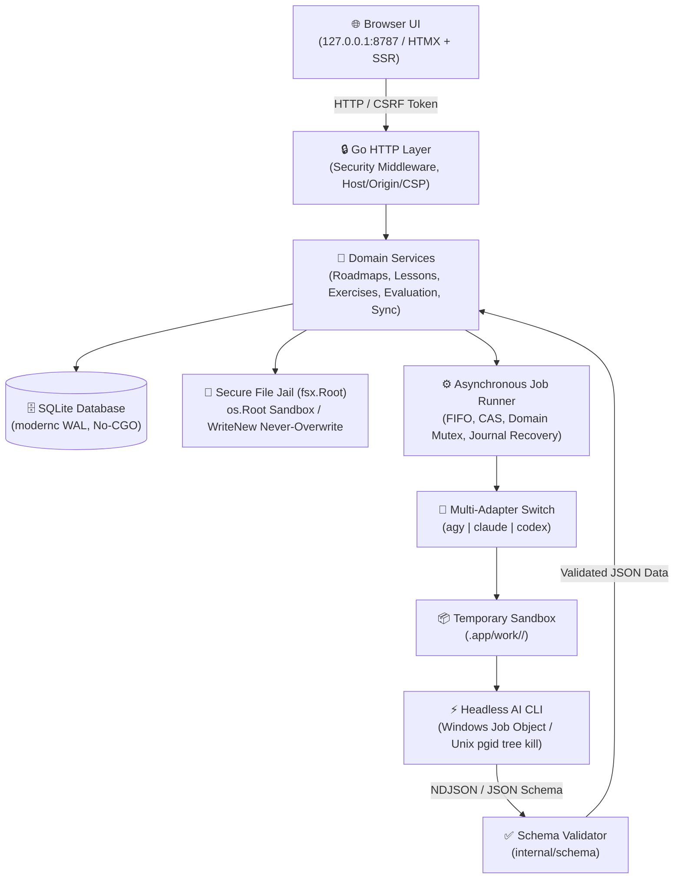

# Learning Hub 🚀

> **Autonomous, Local-First AI Learning Assistant for Software Engineers and Developers**  
> Transform standard Markdown roadmaps into interactive, personalized curriculum with autonomous lesson generation, starter code templates, automated evaluation, and rigorous academic scoring.

[](https://go.dev/)
[-003B57?style=flat&logo=sqlite)](https://modernc.org/sqlite)
[](https://htmx.org/)
[](#installation-guide)

---

## 📖 Table of Contents
- [Overview](#-overview)
- [Key Features](#-key-features)
- [Architecture & Design Principles](#-architecture--design-principles)
- [Prerequisites: AI CLI Engines](#-prerequisites-ai-cli-engines)
  - [1. Google Antigravity (Default)](#1-google-antigravity-agy--default)
  - [2. Anthropic Claude Code](#2-anthropic-claude-code-claude)
  - [3. OpenAI Codex](#3-openai-codex-codex)
- [Installation Guide](#-installation-guide)
  - [Option A: Pre-compiled Single Binary (Recommended)](#option-a-pre-compiled-single-binary-recommended)
  - [Option B: Building from Source](#option-b-building-from-source)
- [Step-by-Step Workflow](#-step-by-step-workflow)
- [Command Line Interface (CLI)](#-command-line-interface-cli)
- [Configuration Reference (`config.toml`)](#-configuration-reference-configtoml)
- [Data Storage & Directory Layout](#-data-storage--directory-layout)
- [Reliability, Crash Recovery & Security](#-reliability-crash-recovery--security)
- [Development & Verification](#-development--verification)

---

## 🌟 Overview

**Learning Hub** is an open-source, local-first platform that turns any programming or engineering syllabus into an end-to-end interactive learning environment. 

Unlike conventional AI tools that unsafely mutate your disk files or execute arbitrary unconfined code, **Learning Hub enforces strict deterministic separation**:
- **The AI acts exclusively as an inference engine** inside isolated, temporary sandboxes, returning strictly structured JSON schema.
- **The Go core engine deterministically controls all disk I/O, database persistence, grading calculations, and file protection.**
- **Your work is permanent and immutable:** your code answers and evaluations are protected by a strict never-overwrite guarantee (`fsx.WriteNew`).

---

## ✨ Key Features

- 🗺️ **Roadmap Ingestion & AST Parsing:** Upload any Markdown roadmap (GitHub READMEs, personal notes, syllabi). The engine parses AST with `goldmark` using selection rules (`deepest`, `level`, `items`, or `tree`); the AI can also suggest a rule or detect chapters.
- 🔄 **Intelligent Re-import Diff Engine:** Update your syllabus at any time without losing study history. Fuzzy Levenshtein diffing highlights new, changed, archived, and unchanged topics.
- 📚 **Comprehensive Lesson Publishing:** Generates deep, contextual lessons in Persian with bi-directional (`<bdi>`) isolation for English code and terms, complete with automated XSS sanitization (`bluemonday`) and revision history (`lesson.NNNN.md`).
- ✍️ **Structured Exercise Sets & Starter Code:** Decomposes lessons into structured practical exercises (`q01`..`qNN`) with language-specific comment headers (`@hub`), starter code, manifest contracts, and evaluation rubrics.
- 🎯 **Automated Evaluation & Pure Deterministic Scoring:**
  - **Incremental & Full Modes:** Grade only modified/new answers while carrying forward unchanged scores.
  - **Isolated Sandboxing:** Grades each exercise independently with persistent checkpoints.
  - **Deterministic Math:** Pure software calculations (`internal/scoring`) sum exact rubric points and calculate weighted topic averages—ignoring any AI hallucinated score totals.
- 🛡️ **Anti-Cheating & Quality Guards:**
  - *Prompt Injection Guard:* Flags student answers attempting to hijack evaluation instructions.
  - *Template High Score Guard:* Detects unmodified starter code receiving unwarranted high marks.
  - *Score Mismatch Detection:* Reconciles discrepancies between criterion points and summary numbers.
  - *Confidential Rubrics:* Rubrics remain strictly locked (HTTP 403) until all exercises have been answered and evaluated.
- 🗃️ **Sync & Disaster Recovery:**
  - **Sync Service:** Scans on-disk user file moves/renames and syncs database metadata atomically via SHA-256 matching.
  - **Database Rebuild:** 100% reconstructs the SQLite database from plain on-disk Markdown and JSON files if the database is deleted or corrupted.

---

## 🏛️ Architecture & Design Principles



### Core Invariants
1. **No CGO:** Uses `modernc.org/sqlite` for zero-dependency compilation across Windows, Linux, and macOS without GCC or MinGW.
2. **Never-Overwrite (`fsx.WriteNew`):** Answers, previous lesson versions, and grade reports are never replaced in-place. File writes occur via temporary files + atomic links + directory `fsync`.
3. **Directory Confinement (`os.Root`):** All filesystem operations are jailed within the user-specified base directory.
4. **Scope-Level Mutual Exclusion:** Only one active job (lesson generation, exercise creation, or evaluation) can run per topic at any given moment.
5. **Headless Multi-Adapter Orchestration:** Full, seamless switching between Antigravity, Claude Code, and Codex without restarting the server.

---

## 🤖 Prerequisites: AI CLI Engines

Learning Hub executes AI CLI tools in **headless mode**. At least **one** of the following tools must be installed, authenticated, and available in your system's `PATH`.

### 1. Google Antigravity (`agy` — Default)
- **Installation:** Install the Antigravity CLI and verify with `agy --version` (tested on v1.5+).
- **Authentication:** Launch `agy` in your terminal and run `/login`. Verify that `agy models` lists available models.
- **Default Model:** `gemini-3.8-flash-medium` (or any model listed in `agy models`).
- **Execution Flags:**
  ```bash
  agy --dangerously-skip-permissions -p <prompt> --output-format stream-json --json-schema <work>/output.schema.json --model <model> --effort <effort> --print-timeout <t> --sandbox
  ```
  *Note:* The `--dangerously-skip-permissions` flag is mandatory in headless mode so `agy` does not block on approval prompts.

### 2. Anthropic Claude Code (`claude`)
- **Installation:** Install Claude Code via npm (`npm install -g @anthropic-ai/claude-code`) and verify with `claude --version`.
- **Authentication:** Run `claude auth login` and ensure `claude auth status` reports `loggedIn: true`.
- **Execution Flags:** Run safely confined to the workspace with read-only tools:
  ```bash
  claude -p <prompt> --tools Read,Glob,Grep --allowedTools "Read(./**),Glob(./**),Grep(./**)" --no-session-persistence --strict-mcp-config --setting-sources ""
  ```
- *Environment:* Claude processes inherit environment variables (e.g., `ANTHROPIC_API_KEY`).

### 3. OpenAI Codex (`codex`)
- **Installation:** Install Codex CLI and ensure `codex --version` works.
- **Authentication:** Run `codex login` and verify status.
- **Execution Flags:**
  ```bash
  codex exec --json --skip-git-repo-check --sandbox read-only ...
  ```

---

## 📦 Installation Guide

### Option A: Pre-compiled Single Binary (Recommended)

1. Get the release binary for your platform (`make release` writes them to `dist/`, together with `INSTALL.md`):
   - **Windows:** `hub.exe`
   - **Linux:** `hub`
2. Create a dedicated directory for your learning hub (e.g., `C:\LearningHub` or `~/learninghub`).
   > ⚠️ **Important:** Do NOT place this directory inside a cloud-synced folder (such as OneDrive, Dropbox, or Google Drive) to prevent file-locking conflicts with SQLite WAL.
3. Place `hub.exe` or `hub` inside your learning directory (or add it to your system `PATH`).
4. Run the health check:
   ```bash
   hub doctor
   ```
   If all components pass, you will see `[OK] ready`.

---

### Option B: Building from Source

**Requirements:** Go 1.26 or higher and Make (optional).

```bash
# 1. Clone the repository
git clone <repository-url> learnai
cd learnai

# 2. Run the automated test suite
go test ./cmd/... ./internal/... ./skills/...

# 3. Build single binary
CGO_ENABLED=0 go build -o hub ./cmd/hub        # On Linux/macOS
CGO_ENABLED=0 go build -o hub.exe ./cmd/hub    # On Windows

# Or build release binaries for Windows and Linux into dist/ (needs a clean git tree)
make release
```

---

## 🚀 Step-by-Step Workflow

### 1. Run Environment Diagnostics
Verify that your base directory is writable and that your configured AI CLI is authenticated:
```bash
hub doctor
```

### 2. Start the Local Hub Server
```bash
hub serve
```
By default, the server binds exclusively to the local loopback interface: **[http://127.0.0.1:8787](http://127.0.0.1:8787)**.

### 3. Import a Roadmap
1. Open [http://127.0.0.1:8787](http://127.0.0.1:8787) in your browser.
2. On initial startup, review and accept the Privacy Notice in **Settings**.
3. Click **"ورود نقشه راه" (Import Roadmap)**.
4. Upload any Markdown file containing syllabus headings.
5. Select a selection rule:
   - `deepest` (Default): Leaf headings (headings with no sub-heading) become topics.
   - `level`: Headings at one chosen level become topics.
   - `items`: Top-level list items under headings become topics.
   - `tree`: Every selected heading at any depth becomes a topic (optionally limited to chosen chapters).
   - Or let the AI suggest a rule or detect chapters for you.
6. Review the interactive preview and click **Confirm**.

### 4. Study Lessons
1. Navigate to any topic in your library.
2. Click **"تولید درس" (Generate Lesson)**. The Job Runner will enqueue and execute the task in the background.
3. The lesson is rendered with syntax-highlighted code blocks, clear terminology, and automatic RTL/LTR isolation.
4. Regenerating a lesson (**"بازتولید درس"**) archives the previous version safely in `lesson/history/lesson.0001.md`.

### 5. Practice with Exercises
1. Open the **"تمرین‌ها" (Exercises)** tab.
2. Click **"تولید تمرین" (Generate Exercises)**. The AI produces 3–12 modular tasks (6 by default) (`q01`, `q02`, ...) with starter code templates and a grading rubric.
3. Switch to the **"فایل‌های پاسخ" (Answer Files)** tab.
4. Click **"کپی مسیر" (Copy Path)** next to any exercise.
5. Open the file in your preferred code editor (VS Code, GoLand, PyCharm, Neovim) and implement your solution beneath the `@hub` comment header.

### 6. Evaluate and Review Reports
1. In the topic panel, open the **"گزارش‌ها" (Reports)** tab.
2. Select **"افزایشی" (Incremental)** (recommended) or **"کامل" (Full)**, and click **"ارزیابی" (Evaluate)**.
3. Review your grade breakdown:
   - Detailed feedback per question (`q01-report.md`) with criteria breakdown, strengths, and actionable educational tips.
   - Overall topic summary score (`summary.md`).
   - Machine-readable progress card (`result.json`).

---

## 💻 Command Line Interface (CLI)

```
Usage: hub <command> [flags]

Commands:
  serve       Start the local web application server (default when no command is given)
  doctor      Probe AI CLI readiness, model availability, and disk permissions
  migrate     Apply database schema migrations (the server must be stopped)
  rebuild     Reconstruct the SQLite database from on-disk markdown and JSON files
  version     Display application version, VCS git revision, and build date

Flags:
  --config    Path to a custom config.toml (serve, doctor, migrate, rebuild)
  --json      Print doctor diagnostics as JSON (doctor only)
  --db        Database file to create; must be new or empty (rebuild only)
```

### Examples:
```bash
# Start server with explicit configuration
hub serve --config /etc/learninghub/config.toml

# Automated health check in CI/scripts
hub doctor --json

# Rebuild corrupted database into a clean new file
hub rebuild --db app-recovered.db
```

---

## ⚙️ Configuration Reference (`config.toml`)

Learning Hub uses the first config file it finds:
1. The `--config <path>` command-line flag.
2. `config.toml` in the current working directory.
3. **Windows:** `%APPDATA%\LearningHub\config.toml` — **Linux/macOS:** `$XDG_CONFIG_HOME/learninghub/config.toml` or `~/.config/learninghub/config.toml`.

With no file, built-in defaults apply and the current directory is the base directory. Unknown keys are rejected and durations need units (`"10m"`). The full commented example is [`config.example.toml`](config.example.toml); the values below are the defaults.

```toml
# base_dir = "/abs/path"           # Base directory (absolute); default: OS data folder (~/.local/share/learninghub, %LOCALAPPDATA%\LearningHub)
listen = "127.0.0.1:8787"          # Must be a loopback address (127.0.0.1, ::1 or localhost)
language = "fa"                    # UI and prompt language
log_retention_days = 30            # Days to keep job logs
backup_keep = 7                    # Daily database backups kept in .app/backup
draft_ttl = "24h"                  # Unconfirmed roadmap import preview lifetime

[adapter]
kind             = "antigravity"   # Active AI engine: "antigravity" | "claude" | "codex" (switchable in Settings)
binary           = "agy"
model            = "gemini-3.8-flash-medium"
effort           = "medium"        # "low" | "medium" | "high" | "xhigh" | "max"
sandbox          = true
skip_permissions = true            # Passes --dangerously-skip-permissions to agy; requires sandbox = true
extra_args       = []              # Any argument containing "dangerously" is rejected

[adapter.claude]
binary = "claude"
model  = ""                        # Empty uses the tool's own default
effort = ""
extra_args = []

[adapter.codex]
binary = "codex"
model  = ""
effort = ""
extra_args = []

[jobs]
max_concurrent         = 1         # Maximum concurrent background jobs
evaluate_parallelism   = 1         # Parallel exercise evaluations within one job
timeout_lesson         = "10m"
timeout_exercises      = "10m"
timeout_evaluate_item  = "5m"      # Per exercise evaluation
timeout_evaluate       = "30m"     # Whole evaluation job
timeout_analyze        = "10m"     # Roadmap rule/chapter detection
stall_timeout          = "6m"      # Kills the CLI if it sends no output for this long
auto_retry             = 2         # Re-queue rate_limited/interrupted jobs this many times (0 = off)
retry_delay            = "2m"      # Wait before each automatic retry

[exercises]
count_default = 6
count_min     = 3
count_max     = 12
allowed_answer_exts = [".go", ".py", ".js", ".ts", ".java", ".c", ".cpp",
                       ".rs", ".sql", ".sh", ".md", ".txt", ".json", ".yaml", ".yml"]

[limits]
max_roadmap_bytes = 1048576        # 1 MB uploaded roadmap
max_answer_bytes  = 204800         # 200 KB answer file
max_lesson_bytes  = 204800         # 200 KB generated lesson
max_source_bytes  = 204800         # 200 KB topic source sent to the AI
max_tree_topics   = 200            # Topics one "tree" import may create

[editor]
command = ""                       # Optional editor template for "Open", e.g. "code -g {{file}}:{{line}}"
```

---

## 📂 Data Storage & Directory Layout

The base learning directory maintains an intuitive, human-readable structure:

```
<base_dir>/
├── app.db                         # Primary SQLite database (WAL mode)
├── config.toml                    # Local configuration file (optional)
│
├── .app/                          # Internal system storage (hidden)
│   ├── hub.lock                   # Single-instance file lock
│   ├── backup/                    # Daily backups (app-YYYY-MM-DD.db)
│   ├── staging/<job-id>/          # Checkpoints during multi-step evaluations
│   ├── work/<job-id>/             # Isolated AI execution sandboxes
│   └── logs/jobs/<job-id>/        # Execution logs (prompt, stderr, response)
│
├── roadmaps/                      # Archived roadmap markdown revisions
│   └── <roadmap-slug>/
│       ├── rev-001.md             # Immutable snapshot of the imported roadmap
│       └── rev-001.choice.json    # Recorded selection rules and exclusions
│
└── topics/                        # Educational curriculum topics
    └── 01-data-structures/
        ├── source.md              # Excerpt from the roadmap for this topic
        ├── source-history/        # Previous sources after a re-import (source.0001.md)
        ├── lesson/
        │   ├── lesson.md          # Current lesson
        │   └── history/           # Previous versions (lesson.0001.md)
        ├── exercises/v1/
        │   ├── exercises.md       # Rendered exercise set
        │   └── manifest.json      # Machine-readable exercise specifications
        ├── .internal/
        │   └── rubric-v1.json     # Rubric criteria (confidential until graded)
        ├── answers/v1/            # Student answer files
        │   ├── q01.py
        │   └── q02.go
        └── reports/v1/            # Official grading reports
            ├── attempt-1/
            │   ├── q01-report.md  # Detailed feedback for exercise 1
            │   ├── summary.md     # Markdown score summary
            │   └── result.json    # Machine-readable evaluation result
            └── attempt-2/
```

---

## 🔒 Reliability, Crash Recovery & Security

### Crash Recovery via Two-Phase Journal
If the server or machine experiences a sudden power loss, terminal closure, or crash during an AI generation commit:
1. Operations write a staged journal (`commit_journal`) before persisting changes to the database.
2. Upon restart, `hub serve` detects incomplete jobs in `running` status.
3. The journal removes orphan staged files whose hashes match the uncommitted transaction and marks the job as `interrupted`.
4. The user can simply click "Retry" in the UI with zero file corruption or state leaks.

### Subprocess Tree Lifecycle Protection
When cancelling an ongoing AI job or shutting down the server:
- **Windows:** Child and grandchild processes are bounded within an OS **Job Object** with `JOB_OBJECT_LIMIT_KILL_ON_JOB_CLOSE`.
- **Linux/macOS:** Subprocesses run in dedicated process groups (`setpgid`) receiving polite `SIGTERM` followed by authoritative `SIGKILL` timers.
- No zombie or orphan AI processes are ever left lingering in the background.

### Web Security Architecture
- **Loopback Enforcement:** Listens on `127.0.0.1:8787` by default; `listen` may only be a loopback address, so the server is inaccessible from external network adapters.
- **CSRF Protection with Auto-Reload:** All mutating requests require valid CSRF tokens. If the server restarts, stale tokens automatically refresh the frontend cleanly.
- **Strict Headers:** Includes `Cross-Origin-Resource-Policy: same-origin`, restrictive `Content-Security-Policy`, and strict `Host` and `Origin` port validation.

---

## 🧪 Development & Verification

Learning Hub features an extensive multi-platform automated test harness covering unit, integration, and concurrency scenarios:

```bash
# Run all automated tests
go test ./cmd/... ./internal/... ./skills/...

# Format check, vet and tests (what CI runs)
make test

# Race detection (needs cgo for the test binary only; shipped builds stay CGO_ENABLED=0)
CGO_ENABLED=1 go test -race ./cmd/... ./internal/... ./skills/...

# Run formatting and static code analysis
make lint

# Check for security vulnerabilities in dependencies
make vuln
```

### GitHub Actions CI
Pushes to `main` and pull requests run on **Ubuntu Latest** (`gofmt`, `go vet`, `go test`, `go test -race`, `staticcheck`, `govulncheck`) and **Windows Latest** (`gofmt`, `go vet`, `go test`).

---

## 📄 License

No license file is included in this repository yet.
