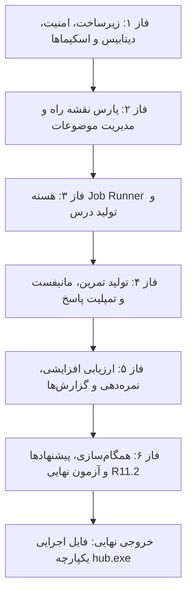

# استراتژی پیاده‌سازی و نقشه راه توسعه دستیار آموزشی هوش مصنوعی (Learning Hub)

این سند مرجع جامع، مراحل اجرایی و نحوه توسعه گام‌به‌گام پروژه دستیار آموزشی مبتنی بر هوش مصنوعی را بر اساس **«سند طراحی فنی — نسخه ۱.۰»** (`technical-design-document.md`) تدوین می‌کند.

---

## ۱. اهداف، دامنه و پشته فناوری

### ۱.۱. اهداف بنیادین
- **یادگیری ساختاریافته محلی (Local-first):** اجرای کامل و مستقل روی ماشین کاربر بدون نیاز به سرور ابری.
- **تفکیک قطعی و غیرقطعی (D4 و R7.5):** هوش مصنوعی (`agy` CLI) فقط تولیدکننده خروجی ساختاریافته (JSON معتبر) در محیط Sandbox موقت است. ساخت فایل‌ها، نام‌گذاری، تغییر و پایگاه‌داده ۱۰۰٪ قطعی و تحت کنترل نرم‌افزار است.
- **تغییرناپذیری فایل‌های کاربر (D7 و R3.3):** پاسخ‌های نوشته شده توسط کاربر و گزارش‌های ارزیابی تحت هیچ شرایطی بازنویسی نمی‌شوند (`fsx.WriteNew`).
- **امنیت محلی سخت‌گیرانه:** انحصار به `127.0.0.1`، بررسی دقیق `Host`/`Origin`/`CSRF`، و ایمنی فایل‌ها با `os.Root` (D12).

### ۱.۲. پشته فناوری انتخاب‌شده
| لایه | فناوری | دلیل انتخاب |
|---|---|---|
| **زبان** | Go 1.24+ (نصب‌شده: Go `1.26.4`) | تک فایل باینری، مدیریت پردازش‌ها با Job Object، پشتیبانی استاندارد از `os.Root` |
| **پایگاه‌داده** | SQLite (`modernc.org/sqlite`) | بدون نیاز به CGO/gcc روی ویندوز، حالت WAL، استقرار صفر |
| **رابط کاربری** | SSR با `html/template` + `htmx` | سبک، بدون نیاز به Node/npm/SPA، سازگار با CSP سخت‌گیرانه |
| **پارس/رندر Markdown** | `yuin/goldmark` + `bluemonday` | پارس قطعی بر پایه AST؛ پاک‌سازی عمیق جهت جلوگیری از XSS |
| **اعتبارسنجی اسکیما** | `santhosh-tekuri/jsonschema/v6` | اعتبارسنجی محلی Draft 2020-12 |
| **مدیریت پروسه‌ها** | Windows Job Object (`golang.org/x/sys/windows`) | متوقف‌سازی کامل درخت پردازش‌های فرزند در لغو و خروج اضطراری |

---

## ۲. متدولوژی توسعه دوطرفه با دستیار هوش مصنوعی (Pair Programming)

توسعه سیستم در قالب ۶ فاز متوالی و برش‌های عمودی انجام می‌شود:

### قواعد توسعه:
1. **استفاده از Adapter شبیه‌ساز (`ai/fake`):** تمامی منطق‌ها، تست‌های لغو، timeout، بازیابی پس از crash و نمره‌دهی با Adapter شبیه‌ساز بدون مصرف توکن و مستقل از اینترنت تست می‌شوند. اتصال به `agy` واقعی در مراحل مشخص انجام می‌شود.
2. **آزمون‌های خودکار پس از هر گام:** هر پکیج قبل از رفتن به مرحله بعد باید تست‌های واحد و کامپایل موفق داشته باشد.

---

## ۳. نقشه راه فازبندی‌شده وظایف (۴۵ کار اجرایی مطابق سند فنی)

### فاز ۱ — آماده‌سازی و زیرساخت مشترک (Tasks T1.1 تا T1.9)
- **T1.1 (بررسی امکان‌سنجی `agy` و دستور `hub doctor`):** اعتبارسنجی اجرای headless، استریم json، خروجی ساختاریافته با `--json-schema` و ثبت در `docs/feasibility-report.md`.
- **T1.2 (قالب `AGENTS.md`):** دستورالعمل‌های هشت‌گانه رفتار مدل در `skills/AGENTS.md.tmpl`.
- **T1.3 (قالب و بارگذار `profile.md`):** پروفایل یادگیرنده (سطح، پیش‌زمینه، زبان فارسی/انگلیسی).
- **T1.4 (مهارت‌های پایه):** توسعه `lesson-generator`، `exercise-generator`، `answer-evaluator`، و `roadmap-analyzer`.
- **T1.5 (اسکلت پروژه و پیکربندی):** فایل `go.mod`، فلگ‌ها، لایه `slog`، قفل تک‌نمونه با `flock`.
- **T1.6 (پکیج `fsx`):** پیاده‌سازی `os.Root`، تابع `safename` (فیلتر نام‌های ویندوز CON/PRN)، تابع `WriteNew`، و هش جریانی SHA-256.
- **T1.7 (میان‌افزار امنیتی HTTP):** اعتبارسنجی `Host`، `Origin`، بررسی `Sec-Fetch-Site`، توکن CSRF، هدرهای CSP و سقف حجم درخواست‌ها.
- **T1.8 (پکیج `store`):** راه‌اندازی اتصال SQLite، اعمال PRAGMAهای بهینه (WAL, busy_timeout)، اجرای مهاجرت `0001_init.sql` و بررسی ایندکس یکتای `uq_jobs_active_scope`.
- **T1.9 (اسکیماهای JSON و Crosscheck):** اعتبارسنجی `manifest`، `rubric`، `result` و اسکیماهای خروجی AI با آزمون‌های منفی و قوانین بین‌فیلدی.

### فاز ۲ — ورود Roadmap و فهرست موضوعات (Tasks T2.1 تا T2.7)
- **T2.1 (پارسر قطعی Markdown):** استخراج سرفصل‌ها و لیست‌ها به صورت درخت با `goldmark` بدون وابستگی به هوش مصنوعی.
- **T2.2 (قواعد انتخاب موضوع):** تعیین عمیق‌ترین سطح سرفصل‌ها به عنوان موضوع و سطوح بالاتر به عنوان گروه.
- **T2.3 (شناسه پایدار `stable_key`):** نرمال‌سازی متن (NFC، ی/ک، نیم‌فاصله، ارقام) و تولید کلید ۱۶ نویسه‌ای پایدار.
- **T2.4 (پیش‌نمایش ورود):** ذخیره موقت در `import_drafts` و نمایش درختی با `htmx` بدون ایجاد هیچ رکوردی تا پیش از تأیید.
- **T2.5 (تأیید و ثبت نهایی):** درج تراکنشی در جدول‌های `roadmaps`, `groups`, `topics` و ایجاد اسنپ‌شات در `roadmaps/<slug>/rev-001.md`.
- **T2.6 (صفحه فهرست موضوعات):** نمایش دسته‌بندی‌ها، جستجوی فارسی، فیلتر وضعیت و نمره با رندر سریع زیر ۳۰۰ میلی‌ثانیه.
- **T2.7 (ورود مجدد و گزارش تفاوت):** تطبیق با `stable_key`، گزارش تغییرات/حذف‌ها و بایگانی موضوعات ناپدیدشده بدون حذف داده‌ها.

### فاز ۳ — هسته Job Runner و تولید درس (Tasks T3.1 تا T3.9)
- **T3.1 (پیاده‌سازی Adapter):** اینترفیس `ai.Adapter`، ماژول `ai/antigravity` با پارسر استریم NDJSON و ماسک اطلاعات حساس در لاگ‌ها.
- **T3.2 (مدیریت پروسه‌های ویندوز با `procgroup`):** انهدام قطعی درخت پردازش‌های فرزند در ویندوز با Job Object ظرف کمتر از ۵ ثانیه.
- **T3.3 (`prompt.Composer` و ساخت Sandbox):** آماده‌سازی پوشه کاری موقت `.app/work/<job>` با کپی‌های محدود ورودی‌ها.
- **T3.4 (هسته صف و ماشین حالت Job):** تضمین حداکثر یک Job فعال در هر scope، سمافور سراسری و بازیابی پس از قطع ناگهانی (Crash Recovery).
- **T3.5 (لغو، Timeout و Stall):** مدیریت لغو توسط کاربر، سقف زمانی کل و نگهبان سکوت جریان.
- **T3.6 (هندلر تولید درس):** اجرای فازهای prepare/ai/validate/commit؛ الصاق قطعی بخش کلیدواژه‌ها به انتهای درس؛ آرشیو نسخه قبلی در `lesson/history/lesson.NNNN.md`.
- **T3.7 (رندر Markdown امن و RTL/LTR):** تفکیک متون راست‌به‌چپ فارسی و کدهای چپ‌به‌راست؛ ایمن‌سازی لینک‌ها و خنثی‌سازی کامل XSS.
- **T3.8 (رابط کاربری موضوع و کارت زنده Job):** پولینگ وضعیت با `htmx` هر ۲ ثانیه، دکمه لغو و پیام‌های خطای فارسی قابل اقدام.
- **T3.9 (صفحه تنظیمات و گزارش Doctor):** نمایش وضعیت احراز هویت، مدل‌های فعال و تأییدیه حریم خصوصی.

### فاز ۴ — تولید تمرین، مانیفست، Rubric و فایل‌های پاسخ (Tasks T4.1 تا T4.6)
- **T4.1 (هندلر تولید تمرین):** ایجاد همزمان `exercises.md`، `manifest.json`، `rubric-vN.json` و فایل‌های پاسخ با اعتبارسنجی اسکیما.
- **T4.2 (قواعد بین‌فیلدی و بازپارس):** تضمین جمع امتیاز ۱۰۰ برای معیارهای هر تمرین و تطابق ۱ به ۱ شناسه‌ها.
- **T4.3 (قالب فایل پاسخ و قانون عدم بازنویسی):** درج کامنت‌های سربرگ و نشانگر پاسخ؛ رد فوری کل commit در صورت وجود قبلی حتی یک فایل پاسخ.
- **T4.4 (نسخه‌های مجموعه تمرین):** ایجاد ست تمرین جدید با شماره نسخه بالاتر (`vN+1`) با حفظ تمام فایل‌های نسخه‌های قبل.
- **T4.5 (رابط کاربری تمرین‌ها و پاسخ‌ها):** نمایش درجه سختی و مسیر کامل فایل پاسخ جهت کپی آسان در ادیتور کاربر.
- **T4.6 (وابستگی‌های دانشی خارج از محدوده):** مشخص‌سازی پیش‌نیازهای خارج از درس و منع صریح کسر نمره در ارزیابی.

### فاز ۵ — موتور ارزیابی، نمره‌دهی و گزارش‌ها (Tasks T5.1 تا T5.8)
- **T5.1 (انتخاب ورودی‌های ارزیابی):** ارزیابی افزایشی (فقط فایل‌های جدید یا تغییریافته)؛ سوالات بدون پاسخ هرگز به AI ارسال نمی‌شوند.
- **T5.2 (ارزیابی تمرین‌به‌تمرین با نقطه‌بازیابی):** فراخوانی جداگانه به ازای هر تمرین؛ امکان ادامه کار در تلاش مجدد از نقطه توقف.
- **T5.3 (پکیج نمره‌دهی قطعی `scoring`):** محاسبه نمره تمرین از جمع نمرات معیارهای عددی؛ محاسبه میانگین وزنی موضوع توسط نرم‌افزار.
- **T5.4 (سازنده گزارش‌ها و وفاداری به بایت‌ها):** تولید `qNN-report.md`، `summary.md` و `result.json` با بازتولید بایت‌به‌بایت کد کاربر درون بلوک گزارش.
- **T5.5 (ثبت تلاش و تاریخچه):** ایجاد پوشه `reports/vN/attempt-K` با برچسب تغییرناپذیر (`immutable=1`) و انتقال نتایج سوالات تغییرنکرده (`carried_over`).
- **T5.6 (محافظ‌های کیفیت و تقلب):** تشخیص ناهنجاری نمره، خنثی‌سازی Prompt Injection، و ثبت نمره مغایر اعلامی مدل.
- **T5.7 (رابط کاربری گزارش‌ها):** نمایش روند تلاش‌ها، جزئیات معیارها و برچسب «ناقص» تا زمان تکمیل تمام تمرین‌ها.
- **T5.8 (تنظیم و سنجش دقت مهارت ارزیابی):** آزمون با ۵ نمونه پاسخ متنوع و ثبت میزان پراکندگی نمره.

### فاز ۶ — پیشنهادها، همگام‌سازی و انتشار نهایی (Tasks T6.1 تا T6.9)
- **T6.1 (پیشنهادهای هوش مصنوعی):** بررسی، تأیید یا رد موضوعات پیش‌نیاز یا تکمیلی بدون تغییر ساختار Roadmap اصلی.
- **T6.2 (تحلیل هوش مصنوعی برای نقشه‌های مبهم):** پیشنهاد سرفصل‌ها در فاز پیش‌نمایش.
- **T6.3 (سرویس همگام‌سازی دیسک):** اسکن تغییرات خارج از برنامه (فایل‌های مفقود، جابه‌جاشده یا جدید) بدون حذف داده‌ها.
- **T6.4 (بازمحاسبه وضعیت‌ها):** به‌روزرسانی وضعیت موضوعات پس از همگام‌سازی.
- **T6.5 (پاک‌سازی و پشتیبان‌گیری):** پاک‌سازی sandbox و تهیه پشتیبان روزانه از دیتابیس با `VACUUM INTO`.
- **T6.6 (باز کردن مستقیم فایل در ادیتور):** اجرای امن فرمان ادیتور کاربر بدون شل.
- **T6.7 (راه‌اندازی اولیه First-run):** نصب اولیه پوشه `.agent/`، فایل `AGENTS.md` و تنظیمات.
- **T6.8 (دستور اختیاری `hub rebuild`):** بازسازی دیتابیس خالی از روی فایل‌های دیسک.
- **T6.9 (آزمون سرتاسری و بسته‌بندی):** اجرای آزمون‌های پذیرش نه گانه R11.2 و تولید باینری مستقل ویندوز `hub.exe`.

---

## ۴. ماتریس ردیابی معیارهای پذیرش (R11.2)

| شناسه | معیار پذیرش R11.2 | کارهای پوشش‌دهنده | نحوه ارزیابی خودکار |
|---|---|---|---|
| **۱** | ثبت دقیق تعداد موضوعات تأییدشده و عدم حذف فایل در ورود مجدد | T2.4, T2.5, T2.7 | مقایسه شمارش رکوردها و هش تمامی فایل‌ها |
| **۲** | تولید و رندر کامل `lesson.md` با کلیدواژه‌ها در انتها | T3.6, T3.7, T3.8 | بررسی ساختار فایل و خروجی HTML |
| **۳** | مانیفست معتبر، تطابق با `exercises.md` و یک فایل پاسخ به ازای تمرین | T4.1, T4.2, T4.3 | اعتبارسنجی JSON Schema + شمارش فایل |
| **۴** | عدم بازنویسی فایل پاسخ و گزارش در تمامی سناریوها | T1.6, T4.3, T5.5 | بررسی هش فایل قبل و بعد از تلاش تکراری |
| **۵** | گزارش تصحیح کامل با بازتولید بایت‌به‌بایت پاسخ کاربر | T5.3, T5.4 | Property test مقایسه بایت‌های ورودی و گزارش |
| **۶** | ارزیابی مجدد = تلاش جدید (`attempt-K+1`) بدون تغییر گذشته | T5.5 | هش پوشه و فایل‌های تلاش قبلی |
| **۷** | حداکثر یک Job فعال در هر موضوع و قابلیت لغو با نمایش وضعیت | T1.8, T3.4, T3.5 | تست ایندکس دیتابیس و سناریوی توقف کار |
| **۸** | مسدودسازی کامل Origin نامعتبر و خروج از دایرکتوری پایه | T1.6, T1.7 | تست‌های نفوذ HTTP و تست ماتریس مسیر `os.Root` |
| **۹** | گزارش دقیق همگام‌سازی بدون حذف یا تخریب داده‌های دیسک | T6.3, T6.4 | سناریوهای جابه‌جایی دستی و مقایسه دیتابیس |

---

## ۵. اقدامات اجرایی بعدی

با ایجاد این دو گزارش در دایرکتوری پروژه، مقدمات کامل شده است. گام بعدی ورود به **فاز ۱ (Task T1.5 و T1.6)** شامل:
1. مقداردهی Git مستقل در `prj` و ایجاد `.gitignore`.
2. ایجاد `go.mod` و ساختار فولدرهای Go.
3. پیاده‌سازی پکیج امنیتی سیستم فایل `fsx` و تست‌های ماتریس مسیر روی ویندوز.
